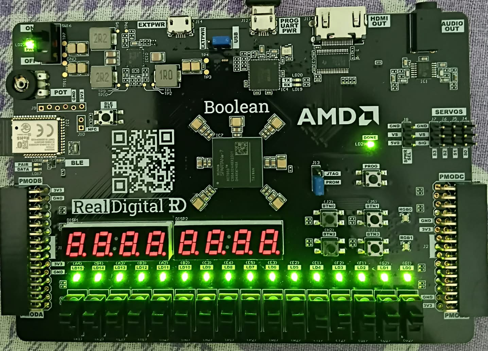

# SPI Master-Slave FPGA Design & Verification

> **SystemVerilog RTL implementation of an 8-bit full-duplex SPI Master-Slave system, verified through simulation, assertions, functional coverage, static checks, timing closure, and real Spartan-7 FPGA hardware validation.**

---

## Architecture Overview

## Project Highlights

- **8-bit full-duplex SPI Master-Slave architecture**
- **270 / 270 functional checks passed**
- **100% functional coverage**
- **0 RTL lint violations**
- **Post-route timing closed successfully**
- **0 DRC errors**
- **CDC-aware board input synchronization**
- **Asynchronous reset assertion with synchronous release**
- **SystemVerilog assertions and coverage**
- **Validated on real Xilinx Spartan-7 FPGA hardware**

---
A synthesizable, verified, timing-clean, FPGA-deployed SPI full-duplex communication project implemented in SystemVerilog and validated on a Real Digital Boolean Board using a Xilinx Spartan-7 FPGA.

## Project Overview

This project implements an SPI master and SPI slave connected in full-duplex mode.

The design supports simultaneous data transfer between the master and slave using MOSI and MISO while generating SPI clock and chip-select control from the master.

The project was developed beyond basic simulation functionality, with emphasis on RTL quality, CDC/reset robustness, lint cleanliness, timing closure, methodology review, FPGA implementation, and physical board validation.

## Target Platform

- FPGA Family: Xilinx Spartan-7
- Device: XC7S50CSGA324-1
- Board: Real Digital Boolean Board
- Tool: AMD Vivado 2025.1
- HDL: SystemVerilog
- System Clock: 100 MHz

## SPI Configuration

- Full-duplex communication
- Data width: 8 bits
- Master-generated serial clock
- Active-low chip select
- Parameterized clock divider
- MSB-first data transfer

## RTL Architecture

Main RTL modules:

- spi_master.sv
  - Generates SCLK and CS
  - Serializes Master TX data on MOSI
  - Samples MISO
  - Produces received byte and transaction status

- spi_slave.sv
  - Operates using the system clock
  - Detects SCLK edges internally
  - Samples MOSI
  - Drives MISO
  - Avoids using protocol SCLK as an internal FPGA clock

- spi_top.sv
  - Connects master and slave
  - Provides full-duplex data path

- spi_board_top.sv
  - FPGA board integration wrapper
  - Reset synchronization
  - Switch synchronization
  - Start-button synchronization and debounce
  - Transaction data capture
  - LED result display

## CDC and Reset Handling

The board wrapper includes:

- Asynchronous reset assertion
- Synchronous reset deassertion
- Two-stage synchronization for asynchronous switch inputs
- Two-stage synchronization for the start button
- Button debounce logic
- Single-cycle start pulse generation
- Stable transaction data capture before SPI transfer starts

The SPI slave was redesigned to avoid using internally generated SCLK as a separate FPGA clock domain.

Instead, SCLK is treated as a protocol signal and its rising and falling edges are detected using the 100 MHz system clock.

This removes the earlier non-clocked sequential methodology issue and keeps the design within a single primary clock domain.

## FPGA I/O Interface

- SW[7:0]   : Master transmit data
- SW[15:8]  : Slave transmit data
- BTN0       : Reset
- BTN1       : Start SPI transaction
- LED[7:0]   : Data received by the SPI slave
- LED[15:8]  : Data received by the SPI master

## Verification and Signoff Results

### Functional Verification

- Total checks: 270
- Passed checks: 270
- Failed checks: 0
- Overall result: PASS

### Functional Coverage

- Master TX coverage: 100%
- Slave TX coverage: 100%
- Master RX coverage: 100%
- Slave RX coverage: 100%
- TX cross coverage: 100%
- Overall functional coverage: 100%

### RTL Lint

- Linter messages: 0
- Warnings: 0
- Critical warnings: 0
- Errors: 0
- Result: PASS

### Timing Analysis

- Post-route timing completed successfully
- All user specified timing constraints are met
- Result: PASS

### Design Rule Check

- DRC errors: 0
- Bitstream precondition DRC: PASS
- Result: PASS

### Methodology Review

- Active methodology checks: 0
- Documented waived checks: 34
- TIMING-17 issue: resolved
- TIMING-18 warnings: documented and waived for asynchronous human-interface board I/O

No artificial input/output delay values were added for manual switches, push buttons, or LEDs.

## Power Estimate

Vivado post-route vectorless estimate:

- Total On-Chip Power: 0.073 W
- Dynamic Power: 0.002 W
- Device Static Power: 0.072 W

## Hardware Validation

The design was successfully programmed and tested on the physical Spartan-7 FPGA board.

| Master TX | Slave TX | Slave RX | Master RX | Result |
|-----------|----------|----------|-----------|--------|
| A5 | 3C | A5 | 3C | PASS |
| 55 | AA | 55 | AA | PASS |
| FF | 00 | FF | 00 | PASS |
| 00 | FF | 00 | FF | PASS |
| FF | FF | FF | FF | PASS |

## Key Engineering Improvements

This project evolved from a basic SPI implementation into a more robust FPGA design by adding:

- Single-system-clock RTL architecture
- CDC-safe asynchronous input handling
- Reset synchronization
- Button synchronization and debounce
- Stable transaction-level switch data capture
- SystemVerilog assertions
- Functional coverage
- RTL lint analysis
- Post-route timing analysis
- DRC and methodology review
- Documented methodology waivers
- Physical FPGA hardware validation

## Final Status

The design successfully passed:

- RTL simulation
- 270 out of 270 functional checks
- 100% functional coverage
- RTL lint
- Synthesis
- Implementation
- Post-route timing analysis
- DRC
- Methodology review
- Bitstream generation
- Multiple FPGA hardware tests

## Skills Demonstrated

SystemVerilog, RTL Design, SPI Protocol, FPGA Design, CDC, Reset Design, Functional Verification, Assertions, Functional Coverage, AMD Vivado, Static Timing Analysis, DRC, Methodology Analysis, FPGA Hardware Validation.

## Architecture

`mermaid
flowchart LR

    SW["SW[15:0] TX Data Inputs"]
    BTN0["BTN0 Reset"]
    BTN1["BTN1 Start"]

    subgraph WRAPPER["FPGA Board Interface"]
        SYNC["2-FF Input Synchronizers"]
        RESET["Reset Synchronizer Async Assert / Sync Release"]
        DEB["Button Synchronizer + Debounce + Pulse"]
        CAP["Transaction Data Capture"]
    end

    subgraph CORE["SPI Core"]
        MASTER["SPI Master 8-bit Full Duplex"]
        SLAVE["SPI Slave System-Clock Based SCLK Edge Detection"]
    end

    LEDS["LED[15:0] Received Data"]

    SW --> SYNC --> CAP
    BTN0 --> RESET
    BTN1 --> DEB

    RESET --> MASTER
    RESET --> SLAVE
    DEB --> MASTER
    CAP --> MASTER
    CAP --> SLAVE

    MASTER -- "MOSI" --> SLAVE
    SLAVE -- "MISO" --> MASTER
    MASTER -- "SCLK" --> SLAVE
    MASTER -- "CS_N" --> SLAVE

    MASTER --> LEDS
    SLAVE --> LEDS
`",
",

- SW[7:0] provides the Master transmit byte.
- SW[15:8] provides the Slave transmit byte.
- BTN0 performs reset.
- BTN1 starts one SPI transaction.
- LED[7:0] displays the byte received by the Slave.
- LED[15:8] displays the byte received by the Master.

---

## Hardware Validation Gallery

The design was validated on a Real Digital Boolean Board using multiple transmit patterns to verify full-duplex SPI communication on physical FPGA hardware.

### Test 1 ? Master TX = A5, Slave TX = 3C

**Observed Result:**  
- Slave RX = A5  
- Master RX = 3C  
- Status: **PASS**

### Test 2 ? Master TX = 55, Slave TX = AA

**Observed Result:**  
- Slave RX = 55  
- Master RX = AA  
- Status: **PASS**

### Test 3 ? Master TX = FF, Slave TX = 00

**Observed Result:**  
- Slave RX = FF  
- Master RX = 00  
- Status: **PASS**

### Test 4 ? Master TX = 00, Slave TX = FF

**Observed Result:**  
- Slave RX = 00  
- Master RX = FF  
- Status: **PASS**

### Test 5 ? Master TX = FF, Slave TX = FF

**Observed Result:**  
- Slave RX = FF  
- Master RX = FF  
- Status: **PASS**

---

